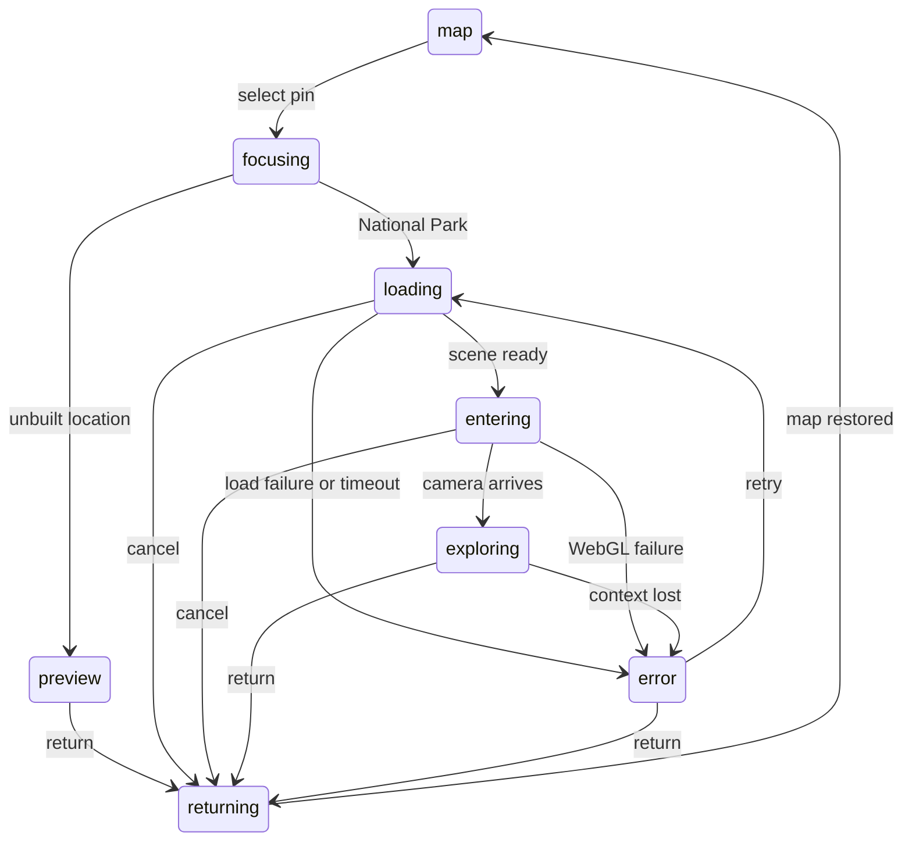

# PokeEarth architecture — Phase 2

## Stack and boundaries

The atlas and HUD use React 19, TypeScript, and Vite. The region overview is local SVG artwork; the ground-level engine uses Three.js and React Three Fiber 9. A lazy boundary separates the WebGL chunk from the map. Plain CSS controls the responsive interface.

Audio uses the browser Web Audio API because this prototype synthesizes its own score and ambience as well as accepting supplied files. A persistent gain bus above the scene owns volume/mute and crossfades; remounting a mesh does not restart audio. Howler is not needed for this implementation.

## File tree

```text
src/
  main.tsx
  App.tsx
  styles.css
  data/regions.ts
  state/explorer.ts
  state/explorer.test.ts
  components/
    RegionMap.tsx
    MapArtwork.tsx
    LocationArtwork.tsx
    SceneLoader.tsx
    ExplorationHUD.tsx
  scenes/
    SceneHost.tsx
    shared/
      EnvironmentRig.tsx
      FirstPersonController.tsx
      movement.ts
      movement.test.ts
    national-park/
      NationalPark.tsx
      layout.ts
      Foliage.tsx
      Fountain.tsx
  audio/
    AudioEngine.ts
    useLocationAudio.ts
    synthesis.ts
    synthesis.test.ts
scripts/browser-check.mjs
.github/workflows/validate.yml
```

## State transitions



Every navigation attempt has a monotonically increasing transition ID. Late load/animation callbacks from cancelled or retried attempts are ignored. The reducer only accepts scene readiness during loading and only enables movement after camera arrival.

The map first focuses its pin over 1.15 seconds. The lazy scene then reveals and moves its local camera from overview through arrival to the player pose over 3.6 seconds. A screen-space fade bridges the unrelated map and world coordinate systems. Reduced motion makes both camera transitions immediate. On return, the scene unmounts, controls release, audio fades out, and the existing atlas animates home.

Map/sidebar controls become inert while the scene is visible. The scene canvas receives keyboard focus when exploration starts. The return button receives focus after errors; return to the atlas restores the destination list focus when that item is present. The background map remains mounted.

## Data and coordinates

`Region` owns the 1,200 × 860 schematic map, routes, towns, and location records. `Location` owns camera presets, lighting/weather, audio layers, scene readiness, seed, bounds, and procedural features.

- Atlas origin: top-left; +X east, +Y south. These are design units, not latitude/longitude.
- Scene units: metres; +Y up. Yaw 0 faces -Z; angles use radians.
- Player position already includes eye height. Do not add eye height again.
- Feature sizes use full extents. Path-ring X size is its outer diameter.
- National Park player spawn: `[0, 1.7, 26]`; playable horizontal limits: -38 to +38 metres.
- The park has a central fountain, inner circular walk, cross-paths, outer walk, two northern grass patches, four benches, entry gateposts, a sign, and perimeter trees.
- `layout.ts` generates the same tree layout for rendering and collisions from the location seed. Foliage is generated once, not randomized every frame.

The atlas and park are stylized interpretations of the requested landmarks. Exact tile layouts require choosing an original game version and calibrating against its location map.

## Movement and rendering

The camera uses yaw/pitch in YXZ order. Pitch is clamped to prevent inversion. Forward and strafe vectors are normalized to avoid faster diagonal movement. Delta time is capped after inactive tabs. Collision movement uses short substeps to prevent tunnelling and separate axes to permit sliding. The fountain/trees use circles; benches, sign, and gateposts use boxes. Horizontal limits contain the player.

Controls clear held keys on blur and visibility change; all listeners are removed on scene unmount. Pointer lock requires an explicit click, is optional, and is released on return. Touch controls use pointer capture and reset on release/cancel/lost capture.

Trees use two instanced meshes (trunks and crowns). Tall grass uses one instanced mesh with vertex-shader wind. Water uses a radial ripple shader and a small animated particle system. Geometry is local, shadows are capped at 2,048 pixels, and device pixel ratio is capped at 1.5. Canvas owns declarative geometry/material disposal.

The configured clear golden-hour environment consumes sky horizon, sun, hemisphere light, fog, exposure, and wind speed. Rain/cloud weather is data for future destinations; precipitation/cloud rendering is not implemented. No GLB loader is present because the MVP uses procedural geometry only.

## Audio

The audio context is created/resumed from the user's location-selection gesture. Entry starts the location layers; the location bus fades up over its configured crossfade duration. A new destination's bus can fade in while the old one fades out. Returning fades current sessions out over 700 ms. The global master bus applies mute/volume independently of location fades.

- Music: original 32-second celesta/pad composition, generated into a PCM buffer.
- Wind: filtered seeded noise.
- Fountain: broad noise and a low-frequency wash.
- All loops fade at their seams and are checked for finite, non-clipping output.
- Music and ambient `src` fields remain null by default; explicit `fallback` values select procedural audio.
- Set `src` to a supplied local audio path to override a fallback. Paths are resolved as configured; use `import.meta.env.BASE_URL` for subfolder deployments.
- Failed audio files do not block exploration. Successful layers continue and the HUD reports partial unavailability.
- Abort signals and generation tokens discard stale loads. Old sources stop and disconnect after fades. Unmount closes the context.

The default score is not the official National Park theme. The soundscape is non-positional in this MVP; distance-based fountain attenuation is a future refinement.

## Adding assets and locations

Custom files belong in `public/assets/models` and `public/assets/audio`. `scene.asset` distinguishes procedural generation from a future GLB URL. To integrate a GLB, add a loading/error-bounded model renderer in SceneHost, retain procedural fallback geometry, and separately define collisions and a clear spawn. Merely changing `modelUrl` does not install a loader.

To add another playable destination, implement its scene/layout renderer, dispatch by `location.scene.id` in SceneHost, then set that location's availability to `ready`. National Park is the only ready scene in this branch. To add another region, extend the artwork renderer, register its `Region` data, enable its selector option, and reset active transitions/cameras on region change.

## Verification

`npm test` runs Node's built-in test runner on navigation lifecycle, collision math, procedural determinism, region data, and audio signal safety. The browser check loads the production bundle in Chromium and exercises desktop entry/movement/mute/return, preview-only locations, mid-flight cancellation, and mobile/reduced-motion entry and movement. GitHub Actions runs these checks and uploads the built site and review screenshots.

The local workspace cannot reach the npm registry (HTTP 403). Unit tests can run locally without dependencies; TypeScript, build, and browser results must come from the branch's GitHub Actions run. Check that run's actual result before treating the branch as validated.
