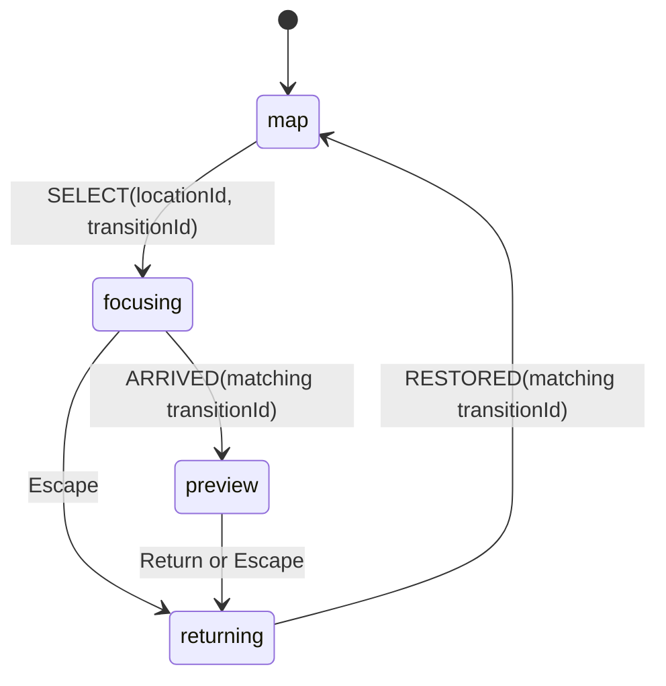

# PokeEarth system architecture

## Technology choice

Use React 19 + TypeScript + Vite for a client-rendered explorer. The MVP has no accounts, server data, or server-rendering requirements, so Next.js adds infrastructure without improving this first phase. If those requirements appear, the components and typed region data can move into a Next.js client boundary.

Phase one uses SVG for the illustrated regional overview: deterministic, resolution-independent, accessible, and independent of a WebGL context. CSS handles the responsive layout; requestAnimationFrame drives camera interpolation. No extra state-management or animation dependency is needed.

Phase two will add Three.js, React Three Fiber 9 (the React 19-compatible major), Drei controls/utilities as needed, and Howler.js for decoded music loops and crossfades. Those packages are not installed or imported by this phase. The first-person scene will be lazy-loaded so the atlas stays light. Procedural mesh geometry, seeded foliage, and shader-based grass/water will supply the scene without remote GLB dependencies.

References:
- https://r3f.docs.pmnd.rs/getting-started/installation
- https://vite.dev/guide/

## Ownership

| Module | Owns |
| --- | --- |
| `data/regions.ts` | Serializable region and location configuration; IDs; coordinates; camera, environment, sound, and asset contracts |
| `state/explorer.ts` | Explicit exploration phases and stale-event protection |
| `App.tsx` | Selected destination, search/hover UI, accessible announcements, return navigation |
| `components/RegionMap.tsx` | Viewbox camera, animation lifecycle, pin activation, pan/zoom |
| `components/MapArtwork.tsx` | Local schematic Johto terrain, routes, towns, forests, mountains, and water |
| `components/LocationArtwork.tsx` | Locally rendered location previews |
| `styles.css` | Responsive interface, focus states, motion preference |

Map pins refer to scene IDs; they never import a scene directly. The `regions` registry currently contains Johto only. Region IDs also cover future regions, while `Partial<Record<RegionId, Region>>` prevents implying that unbuilt regions are selectable.

## Current state transition

1. Selecting a pin or list item records its ID and increments a monotonically increasing transition ID.
2. The map interpolates its camera center and scale toward the pin using smoothstep `t*t*(3-2*t)`. Duration is 1,150 ms, or zero under reduced motion.
3. The final animation frame emits ARRIVED. Only the matching in-flight transition can complete. This prevents stale callbacks after cancellation or a later selection.
4. The location preview appears, announces the destination, and focuses the return button. It explicitly identifies first-person mode as phase two.
5. Return or Escape starts a new transition to the configured regional overview. Completion restores keyboard focus to the destination list item when present.

The map stays mounted throughout, preserving the regional artwork and avoiding reloads. The current return restores the region's home camera rather than the user's last pan position.

## Planned first-person handoff — not implemented in this delivery

Extend the reducer with loading, entering, exploring, and recoverable error states. A scene registry maps each `scene.id` to a lazy-loaded scene module. National Park will be implemented first; the other locations must keep their preview-only status until they have scenes.

- Selection starts the map focus animation and preloads the chosen scene.
- Entering waits for both the map animation and the scene-ready signal.
- Mount the scene with its local overview camera, then animate through `camera.arrival` to `camera.player`. Map units are not interpolated directly into scene metres. A brief screen-space dissolve joins the independent coordinate systems.
- Keep controls disabled during the camera motion. At the player pose, enable WASD and drag-to-look. Pointer lock is optional and requested only from a deliberate user gesture.
- Escape or Return releases pointer lock, disables input, fades out audio, restores the regional camera, and returns keyboard focus.
- Scene-load failures display a retry/return control. The map remains usable.

Planned new modules (these are architectural boundaries, not empty source files):

| Module | Responsibility |
| --- | --- |
| `scenes/SceneHost.tsx` | Lazy loading, errors, Canvas lifecycle, ready signals |
| `scenes/registry.ts` | Scene-ID-to-module mapping |
| `scenes/national-park/NationalPark.tsx` | Fountain, circular paths, grass, tree boundary |
| `scenes/shared/EnvironmentRig.tsx` | Sky, lights, fog, weather, exposure |
| `scenes/shared/FirstPersonController.tsx` | Movement, mouse/drag look, collision and bounds |
| `scenes/shared/Foliage.tsx` | Seeded placement and instanced rendering |
| `audio/AudioProvider.tsx` | Long-lived audio bus, mute, volume, cleanup |
| `audio/useLocationAudio.ts` | Location-change crossfades and ambient layers |
| `components/ExplorationHUD.tsx` | Return, volume/mute, controls help |

## Data schema

`Region` holds the atlas design dimensions, its home camera, locations, contextual towns, and schematic routes. `Location` holds identity, prose, map pin placement, preview colors, landmarks, local scene cameras, environment, audio, procedural geometry hints, bounds, and deterministic seed.

| Location | Pin (x, y) | Focus scale | Player spawn (x, y, z) | Lighting | Music hook |
| --- | --- | --- | --- | --- | --- |
| National Park | 548, 388 | 2.4 | 0, 1.7, 26 | Golden hour | national-park-theme |
| Ecruteak City | 588, 278 | 2.4 | 0, 1.7, 28 | Sunset / haze | ecruteak-theme |
| New Bark Town | 930, 590 | 2.4 | 0, 1.7, 20 | Morning | new-bark-theme |

Coordinates:

- Atlas: 1,200 × 860 design units; origin top-left, x east/right, y south/down. Values are schematic placements, not geographic latitude/longitude.
- Scene: metres; right-handed; Y up; yaw zero faces -Z; rotations in radians.
- `camera.player.position` is the eye position, already including `eyeHeight` (do not add it twice).
- `bounds` describe the playable volume. A controller must constrain horizontal movement; the scene must also supply collider geometry for objects within it.
- Path-ring `size` is its outer bounding diameter on X/Z, not its radius. Feature sizes are full extents.
- Seeds must drive a deterministic generator; never call unseeded random placement on each React render.
- Fog near/far and camera clipping distances are in metres. Wind direction is a vector to normalize in the shader; speed is a scene animation multiplier. Cloud cover, precipitation, and gust strength use 0–1 values.
- Music and ambient volume use 0–1. Crossfade duration uses milliseconds.

## Audio integration contract

The map initializes no audio. All `src` fields are `null`, expressing deliberate absence without broken requests. After supplying local tracks, update the data to base-aware paths. The music layer also names its intended theme, so tracks are decoupled from location names.

The phase-two manager should create the audio context from a user gesture, keep one persistent audio bus above the scene switch, load the next track before fading, and fade old and new music concurrently. Track-load failure leaves exploration usable and shows an audio-unavailable state. A null music source means silence or procedural ambience, never a speculative fetch. Global mute and volume apply during transitions and must not be overwritten by a fade. Disconnect and unload retired sources after fades finish.

## Asset strategy

`scene.asset` is a discriminated union: `{ mode: 'procedural', modelUrl: null }` or `{ mode: 'gltf', modelUrl: string }`. Procedural features remain the fallback; GLB assets will only be loaded when explicitly configured. Put future files in `public/assets/models` and audio in `public/assets/audio`. Resolve public paths against Vite's base path for subfolder hosting.

The future asset loader should retain separate collision geometry and spawn coordinates, use a loading/error boundary, dispose geometries/materials on unmount, and avoid remote dependency URLs. National Park's repeated tree and grass geometry should use instancing; cap device pixel ratio and shadow-map resolution for mobile. Asset failures must not strand a user in a black screen.

## Adding another region

1. Add its complete `Region` data and register it in `regions`.
2. Add its own map artwork renderer and extend the map artwork discriminator/registry. Route lines, pins, labels, and views remain data-driven.
3. Populate scene IDs and the phase-two scene registry for finished locations.
4. Enable it in the region selector only after its atlas is available.
5. Cancel active transitions on region switches and reset the map to that region's home camera.

The single-region app currently renders Johto explicitly. The region selector lists other planned regions as disabled, rather than presenting nonfunctional controls.
